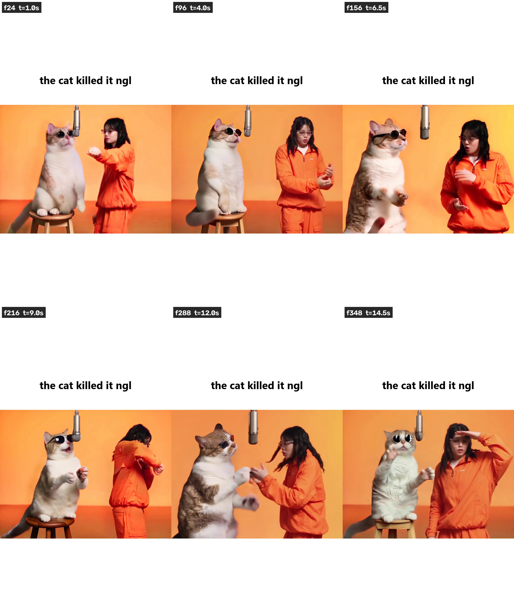
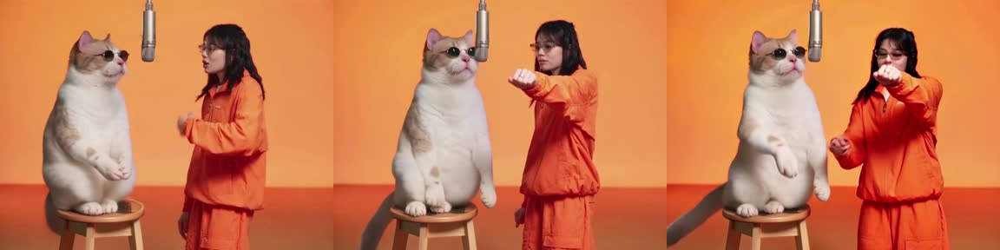

# open-genjutsu

**Higgsfield's Genjutsu "motion transfer" effect, rebuilt on ComfyUI with open weights only.**
Drop a performance clip and one reference photo per character. The app regenerates each
character on the clip while the motion, camera, framing and audio stay, then makes the new
character's mouth move to the vocals.

Entry for Comfy Org's [Open Source Higgsfield](https://comfy.org/open-source-higgsfield) challenge.
Categories: **Best Overall** and **Open Weights Only** (no partner nodes, no closed APIs).

<p align="center">
  
</p>

Demo render: [`demo/cat_rap_example.mp4`](demo/cat_rap_example.mp4) (15 s, 960x720, 24 fps, lip-synced).
The grey cat in Higgsfield's Genjutsu example clip is replaced by a real orange tabby from one
photo; every paw gesture, head turn and camera cut is the original's. Rendered end to end on a
laptop iGPU (Intel Arc 140T, 16 GB shared) in about 1.5 h.

## What the effect is

Genjutsu Motion Transfer takes a video and some reference images and re-performs the video with
the reference characters. The closed version runs in Higgsfield's cloud. This repo does the same
thing with:

| stage | open model | where it runs |
|---|---|---|
| who is where in the frame | YOLOX-m (HumanArt) + RTMW-x whole-body pose, 133 keypoints | ONNX Runtime |
| character matte | ISNet general-use | ONNX Runtime |
| character regeneration | **Wan2.2-Animate-14B** (GGUF Q4_K_M) in *replacement* mode, with the lightx2v step-distill and Wan-Animate relight LoRAs | **ComfyUI** (`WanAnimateToVideo`) |
| 12 to 24 fps | RIFE (ncnn Vulkan) | GPU |
| mouth moves to the vocals | UVR-MDX-NET vocal isolation + **LivePortrait animals v1.1** driven by an RMS mouth curve | torch |
| optional 2x restore | SeedVR2 | ComfyUI |

Every weight is downloadable from Hugging Face or GitHub. Nothing calls out to a service.

## How it is built

```
source clip ──► pose_body.py ──► per-side skeleton PNGs + character masks + ISNet mattes
            └─► face_crops.py ──► 512px face crops of the performer being replaced
reference photo ──► make_refs.py ──► 1024px matted character plate on the set colour

wan_animate.py  builds the ComfyUI graph (workflows/wan_animate_replace.json) once per 33-frame
                window and chains windows with continue_motion; resumable; probe mode renders
                the first window only so a new reference is checked in ~15 min, not 1.5 h
deflicker.py    removes the brightness pulse a temporally-tiled causal VAE decode leaves
to30.py         RIFE 2x to 24 fps
mouth_curve.py  vocals ──► per-frame mouth-open amount (band-pass RMS, gate, attack/release)
lip_pass.py     LivePortrait animals: adds only the mouth delta, pasted back through a feathered
                mouth ellipse so fur, glasses and lighting from the Wan render stay intact
finish.py       audio re-mux at the source offset, 9:16 compose, audio/video sync checks
```

The ComfyUI graph that does the heavy lifting is exported in two forms:

- [`workflows/wan_animate_replace.json`](workflows/wan_animate_replace.json): drag onto the ComfyUI canvas.
- [`workflows/wan_animate_replace.api.json`](workflows/wan_animate_replace.api.json): the API-format
  prompt `wan_animate.py` POSTs to `/prompt`, one window with placeholders for the input folders.

`workflows/export_workflow.py` regenerates both from the Python graph builder, so the file on
disk is always the graph that actually rendered the demo.

Things that took real work and are reusable on their own:

- **Replacement mode on a two-person clip.** The pose, mask and face inputs are built per side,
  so one performer can be recast while the other stays pixel-exact. `cat_pose.py` retargets a
  human skeleton to seated-cat proportions (big head, short forelegs, no fingers) so the model
  draws a cat instead of a furry human.
- **Fur-only masks** (`make_fur_mask.py`): repaint the animal but keep its costume and the stool
  from the source.
- **Shot-aware everything.** Windows restart at cuts, deflicker never smooths across a cut,
  RIFE and SeedVR2 are segmented at cuts, and `-FixShot N` re-renders one camera shot with a
  tighter mask and a new seed and splices it back (before/after: `docs/images/shot_fix_compare.jpg`).
- **Decode flicker root cause.** `VAEDecodeTiled` with `temporal_size` smaller than the window
  restarts the causal Wan VAE every chunk and each restart decodes brighter. Fix: decode the whole
  window in one temporal chunk (`--decode-frames 64`). `deflicker.py` repairs old renders with a
  per-channel quantile envelope.
- **A lip pass that works on animals.** LivePortrait's expression space is calibrated on two
  photos of the same cat (mouth closed, mouth open); the mouth direction is then scaled by the
  vocal curve per frame (`docs/images/lip_pass_strip.jpg`).
- **16 GB iGPU memory discipline.** `--reserve-vram 4` forces a partial load of the 11 GB model so
  the sampler has room; the run scripts resume finished windows after a "device lost".

## Second app: POV Switch, any clip becomes a first-person game

Drop a clip, pick anyone in it (the detector finds people and animals; a "someone else here" card
covers the rest), see that exact moment through their eyes, choose how it ends, keep playing from
the last frame. Inspired by the "Halo Wars, but first person" meme.

- Moments of decision: shot cuts by HSV-histogram correlation, motion peaks inside shots, ranked by
  who is in frame (YOLOv10m, CPU, seconds).
- Their eyes: Qwen-Image-Edit-2509 (GGUF Q4, 4-step Lightning) rewrites the source frame as that
  character's first-person view, 1:1 with the clip.
- The outcome: Wan2.2 I2V A14B (GGUF Q4, two experts, 4-step lightx2v) plays it forward from the
  POV frame. Every result is a branch in a tree.
- Both are single `comfy deploy run` jobs against the same deployment (release v2 of the build).

Details and how to run: [`game/README.md`](game/README.md).

## Render Studio

A local web app over the pipeline so nobody has to touch a node graph or a terminal:
render monitor with ETA and OOM alerts, drag-in reference photos that become a reference plate,
shot review with A/B lanes and a wipe, approve or re-roll per shot.

```
powershell -ExecutionPolicy Bypass -File studio\run_studio.ps1    # http://127.0.0.1:8765
```

Details in [`studio/README.md`](studio/README.md). FastAPI + Svelte 5.

## Comfy developer platform build

`comfy-build.yaml` is the environment scanned from the install that rendered the demo: ComfyUI
v0.37.0, the three node packs pinned to the exact commits, and all nine weights with sha256
digests. With [comfy-cli](https://github.com/Comfy-Org/comfy-cli) (`pip install -U comfy-cli`):

```
comfy build validate comfy-build.yaml          # offline
comfy build push comfy-build.yaml              # needs `comfy cloud login`; public weights dedupe to fetches
comfy build release create comfy-build.yaml --target linux/nvidia --watch
```

A release of this spec is already built and green on the platform (Build `2ba4aa66-00cf-4905-9dcc-347f5acbb29c`,
release `b0400e09-05c1-43fd-80e5-61c72f361e97` v1, Linux NVIDIA cu130, cut 2026-11-02). Seven of the nine
weights resolved to verified public Hugging Face sources by digest; only the two ViTPose files were uploaded.

**It is deployed and tested.** `run_cloud.py` is the same render as `wan_animate.py`, but each
33-frame window is one `comfy deploy run` against the deployment: the laptop does the cheap
per-frame prep (pose, masks, face crops), uploads them as four small H.264 clips plus the reference
plate (18 MB total, deduped by hash), the 48 GB RTX PRO 6000 worker renders the window, and the
returned mp4 is decoded back to frames so `deflicker.py`, `to30.py` and `lip_pass.py` run unchanged.
The graph it submits is `workflows/wan_animate_replace_cloud.api.json`.

| | local Arc 140T iGPU | deployment (RTX PRO 6000 MIG 48 GB) |
|---|---|---|
| 33-frame probe window | ~15 min | 81 s wall, including upload and download |
| full 181-frame block | ~1.5 h | ~7 min projected |

<p align="center"></p>

```
comfy deploy status comfy-build.yaml                       # must be ready
python run_cloud.py --block E --side L --ref refs/cat_body_base_hq.png --name cat_cloud     --prompt "..." --width 768 --height 576 --length 33 --stride 2 --probe 33
```

The deployment scales to zero between jobs (`--min 0 --max 1`), so it costs nothing while idle.

The spec expects `models/` and `custom_nodes/` next to it (symlink or junction them to your
ComfyUI install's folders). Pip pins are intentionally emptied for the first cut because the
source environment was torch XPU on Windows.

## Run it

Setup for NVIDIA (CUDA) and Intel Arc (XPU) is in [`docs/SETUP.md`](docs/SETUP.md).
Reproducing the demo and recasting your own clip: [`docs/OWN_CLIP.md`](docs/OWN_CLIP.md).

Short version, once ComfyUI and the models are in place:

```
powershell -ExecutionPolicy Bypass -File run_example.ps1 -Side cat -Probe   # 33 frames, ~15 min
powershell -ExecutionPolicy Bypass -File run_example.ps1 -Side cat          # full, resumable
python to30.py --in work_ex/wan/cat_E/frames --out work_ex/cat24 --method rife --n-out 361
.venv-lp/Scripts/python.exe lip_pass.py run --frames work_ex/cat24 --out work_ex/cat24_lips --strength 1.2
python finish.py --blocks work_ex/blocks.json --input work_ex/wan/cat24_lips.mp4 --out work_ex/final.mp4
```

## Honest limits

- The run scripts are tuned for the demo clip (24 fps, 960x720, five camera shots). Other clips
  need their own `blocks.json` and prompts; `docs/OWN_CLIP.md` walks through it.
- Identity of a *human* replacement drifts between shots when the reference face is small.
  Use a close-up for the reference plate (Studio > References shows the face size).
- Wan2.2-Animate-14B Q4 needs about 12 GB of GPU memory with the 4 GB reserve. Smaller GGUF quants
  work with lower quality.
- The pose and matte stages use ONNX Runtime with DirectML on Windows; on Linux use the CUDA
  provider (`docs/SETUP.md`).
- The CUDA setup path is written from the ComfyUI defaults and has not been exercised on an
  NVIDIA machine by the author; the XPU path is the one the demo was rendered on.

## Repo map

| path | what |
|---|---|
| `wan_animate.py`, `wan_animate2.py`, `seedvr2_upscale.py` | ComfyUI graph builders and window drivers (local ComfyUI) |
| `run_cloud.py` | the same render against a Comfy developer platform deployment |
| `pose_body.py`, `cat_pose.py`, `face_crops.py`, `make_fur_mask.py`, `make_refs.py`, `make_cat_ref.py` | per-frame inputs and reference plates |
| `deflicker.py`, `to30.py`, `splice_frames.py`, `shot_fix_inputs.py` | post passes |
| `mouth_curve.py`, `lip_pass.py`, `animate_cat.py`, `vendor/lp_harness/` | lip sync |
| `finish.py`, `compose.py`, `judge_take.py`, `track.py` | mux, layout, QA |
| `run_example.ps1`, `run_render.ps1`, `run_cat_fix.ps1` | one-command renders (start ComfyUI, render, splice) |
| `studio/` | Render Studio web app |
| `game/` | POV Switch: analyzer, graphs, server, UI |
| `workflows/` | exported ComfyUI graph + exporter |
| `comfy-build.yaml` | Comfy developer platform build spec (models, node packs, ComfyUI ref) |
| `kaggle/` | the same render on a Kaggle T4 |
| `docs/history/` | design record, runbook and lessons from the build (Sep to Oct 2026) |

## License

MIT. Model weights keep their own licenses (Wan 2.2: Apache-2.0; LivePortrait: MIT; RIFE: MIT;
ISNet: Apache-2.0; RTMW/YOLOX via rtmlib: Apache-2.0).
