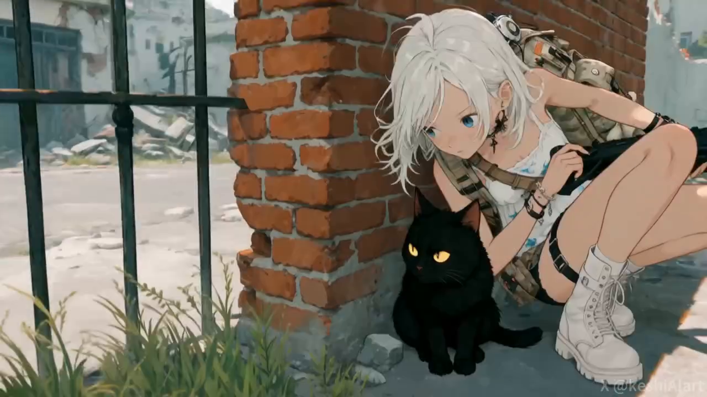
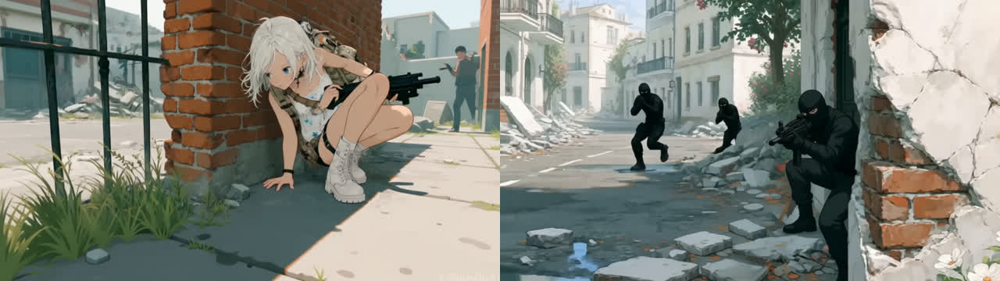
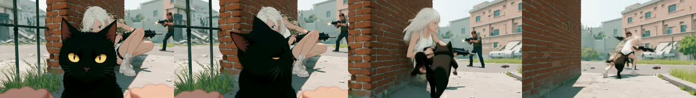
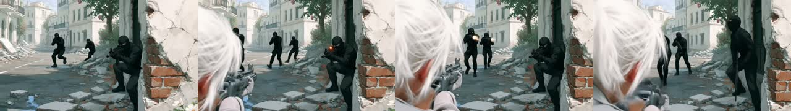
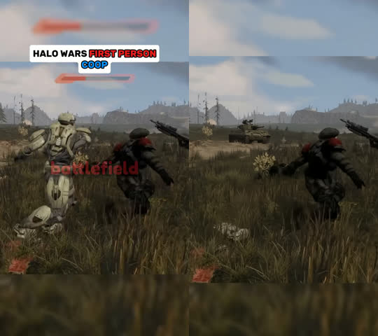

# POV Switch

Turn any clip into a playable, branching first-person game. Drop a video, pick anyone in it, see
the moment through their eyes, choose how it ends, keep going.

Inspired by the "Halo Wars, but first person" meme: the same battle, seen from inside it. Here it
works on any footage, including the cat.

## How to play

1. **Drop a clip.** The analyzer samples frames, finds shot cuts (HSV histogram correlation) and
   the peaks of motion inside each shot, and runs YOLOv10m on the candidate peaks. The moments of
   decision are the peaks with someone in them.
2. **Pick a moment, then whose eyes.** Every detected person or animal is a card with a 1:1 crop.
   There is always a "someone else here" card for things the detector cannot name (a marine in a
   game render, a car): you type who you are.
3. **See it from their eyes.** Qwen-Image-Edit-2509 rewrites the exact source frame as that
   character's first-person view, same place, same moment, everyone else where they were.
4. **Choose the outcome.** "I win", "I lose", "draw", "run", or your own words. Wan2.2 I2V plays
   the next three seconds forward from the POV frame with that outcome.
5. **Keep going.** The last frame of every outcome is a new decision point, so the clip becomes a
   tree of branches, all shown under the stage.

## It works

Source moment of the sample clip, then the same instant through the black cat's eyes (left) and
the white-haired girl's eyes (right), both generated on the deployment:

<p align="center"></p>
<p align="center"></p>

The cat's outcome "leaps out, dodges the gunfire and pounces on the gunman" played forward with
Wan2.2 I2V (`demo/game_cat_outcome.mp4`, 49 frames, 842x473):

<p align="center"></p>

The girl's outcome "we open fire and take down all three gunmen" (`demo/game_girl_outcome.mp4`):
rifle in hand, the gunmen return fire, her hair intrudes at the edge. Honest limit: the video model
still likes to drift toward an over-the-shoulder view on human characters.

<p align="center"></p>

The meme itself, from the "Halo Wars first person" clip: a third-person moment (left) and the same
instant through the Spartan's eyes (right), typed in on the "someone else here" card because COCO
YOLO does not know a Spartan:

<p align="center"></p>

| job | model | wall time on the RTX PRO 6000 MIG 48 GB, incl. upload and download |
|---|---|---|
| POV frame, 1280x720 | Qwen-Image-Edit-2509 Q4, 4 steps | 19 to 41 s |
| outcome clip, 49 frames | Wan2.2 I2V A14B Q4, 2 + 2 steps | 62 s |

## What we learned about the prompts

- The edit model keeps the subject by default. "Show this from X's point of view" returned X facing
  the camera. It works once the prompt says X is removed from the picture, the camera sits at X's
  eye height (a few centimetres off the ground for a cat), and at most X's own paws or hands may
  show at the bottom edge.
- The video model walks a named character back into frame. An outcome written as "she opens fire"
  produced a third-person shot within a second. The outcome prompt now states "we are X, X is never
  shown", and the negative prompt lists "third person, over-the-shoulder, character walks into
  frame". Outcomes read best in the first person plural: "we open fire".

## What runs where

| step | model | where |
|---|---|---|
| frames, cuts, peaks | ffmpeg + OpenCV | laptop CPU, seconds |
| characters | YOLOv10m ONNX (COCO) | laptop CPU |
| POV frame | Qwen-Image-Edit-2509 GGUF Q4 + Lightning 4-step LoRA | Comfy platform deployment, one `comfy deploy run` |
| outcome clip | Wan2.2 I2V A14B GGUF Q4, high + low experts, lightx2v 4-step LoRAs | same deployment, one `comfy deploy run` |

All weights are open and resolved by sha256 to public Hugging Face sources in `comfy-build.yaml`
(release v2 of the build). Both graphs are in `game/graphs.py` and are plain API-format prompts;
nothing custom beyond ComfyUI-GGUF and VideoHelperSuite.

## Run it

```
.venv/Scripts/python.exe -m uvicorn game.server:app --host 127.0.0.1 --port 8766
```

Needs the pipeline venv (section 1 of `docs/SETUP.md`), ffmpeg, `comfy cloud login`, and the
deployment in `ready` state on release v2 (`comfy deploy status comfy-build.yaml`). The analyzer
alone runs with no deployment:

```
python game/analyze.py --video clip.mp4 --out work_ex/game/my-clip
```

## Files

| path | role |
|---|---|
| `game/analyze.py` | clip -> `analysis.json` (moments, characters, crops) |
| `game/graphs.py` | the two ComfyUI graphs + the prompt templates |
| `game/server.py` | FastAPI: upload, POV, outcome, continue, game tree |
| `game/ui/index.html` | the game screen |
| `game/PLAN.md` | the plan and the assumptions made without asking |
